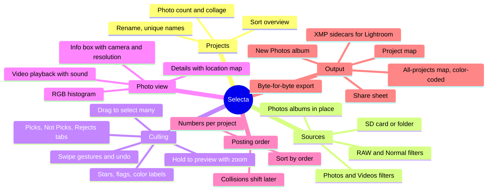
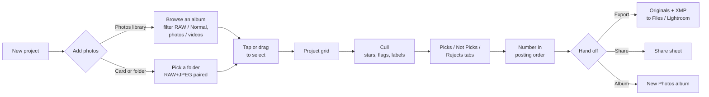
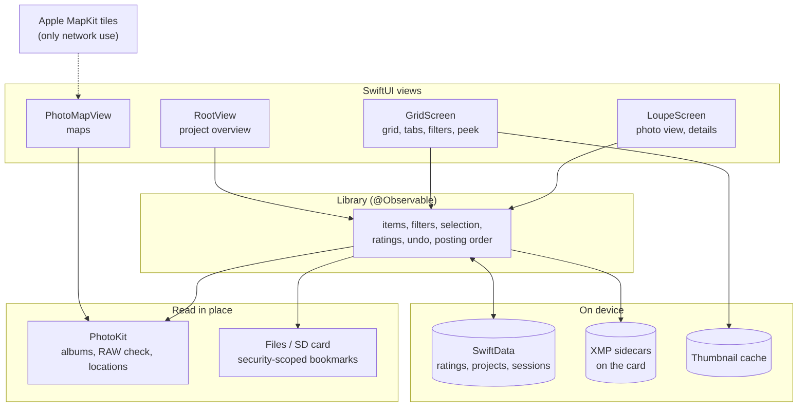
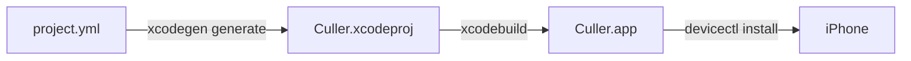

# 📸 Selecta

A fast photo-culling app for iPhone, in the spirit of Adobe Bridge and Photo Mechanic. Gather shots from your **Photos library** or straight off an **SD card**, rate and flag them at speed, put the keepers in posting order, and hand the untouched originals on to Lightroom, Photos or a share sheet.

> **Selecta never modifies, re-encodes or deletes your originals.** Exports are byte-for-byte copies with their original filenames, and nothing is ever silently overwritten.

## What it does

- 🗂️ **Projects.** A project collects the shots you pick for one job: a trip, a shoot, a post. Rename it, sort the overview (recently opened, newest, oldest, name, most photos). Names are unique.
- 📥 **Two sources.** Browse any Photos album in place (nothing is copied), or open an SD card or folder. RAW+JPEG pairs (`DSC01234.ARW` + `DSC01234.JPG`) show as one shot.
- 🔎 **RAW filter that scales.** In big albums like Recents, the RAW / Normal filter checks the whole album in batches in the background. Results fill in as they're found and are remembered.
- ⭐ **Cull at speed.** 0–5 stars, pick / reject flags, Lightroom color labels. Swipe up for +1 star, down to reject, sideways to move on. Undo is always one tap away.
- 👆 **Hold to preview.** Press and hold a thumbnail for a large preview; pinch to zoom into it. It stays open while your finger moves and closes when you let go.
- 🔢 **Posting order.** Give selected photos numbers (1 = post first). Taking a number that's in use pushes the older photo, and the run after it, one later.
- 🗺️ **Maps.** Geotagged shots show their spot in Details. Each project has a map of its photos (it follows the current tab and filters), and the projects screen has one map of everything, color-coded by project with chips to show or hide each one. Tap a pin to jump to that shot or project.
- 📤 **Out the door.** Export originals (RAW, JPEG or both) with XMP sidecars for Lightroom, share them, or create a Photos album from a selection.
- 🔒 **Stays on your phone.** No accounts and no servers. The only network use is Apple's map tiles when you open a map.

### The screens

```
 Projects                    Project grid                Photo view
┌─────────────────────────┐ ┌─────────────────────────┐ ┌─────────────────────────┐
│ (?)(⇅)   SELECTA    (+) │ │ ‹ (…)  Summer Trip  Sel │ │ ⌄  ✓    ◎map  ↶  ▥  ⓘ … │
├─────────────────────────┤ │ All  Picks  Not Picks … │ │ IMG_0111.HEIC  30.03.18 │
│ ┌────────┐ ┌────────┐   │ │ ★ Rating  ⚑ Flag  ◇ …   │ │ 3 of 40  RAW            │
│ │ ▣ ▣    │ │ ▣ ▣    │   │ ├─────────────────────────┤ │ ƒ/2.4 · 1/209 s · ISO 16│
│ │ ▣ ▣    │ │ ▣      │   │ │ ▣  ▣  ▣  ▣              │ │ iPhone 13 · 4032×3024   │
│ └────────┘ └────────┘   │ │ ①  ▣  ②  ▣  ← post order│ │    ┌───────────────┐    │
│ Summer Trip City Walk   │ │ ▣  ▣  ▣  ▣              │ │    │     photo     │    │
│ 40 photos   12 photos   │ │                         │ │    └───────────────┘    │
│                         │ │ hold   = big preview    │ │ ⚑ Pick ⊗ Reject ☆☆☆☆☆   │
│ ⇅ sort · … rename/delete│ │ pinch  = thumbnail size │ │ ▣ ▣ ▣ ▣  filmstrip      │
└─────────────────────────┘ └─────────────────────────┘ └─────────────────────────┘
```

### Feature map



## How a project flows



### Posting order, by example

Numbers live per project. Placing a photo on a number that's taken moves the older photo **one later**, along with everything directly after it. A gap stops the shift.

```
before:   A=1   B=2   C=3         E=5
place N at 2
after:    A=1   N=2   B=3   C=4   E=5      (B and C moved; the gap at 4 absorbed it)
```

## How it's built



```
Culler/
  App/            entry point, SwiftData container
  Models/         CardItem, ProjectRecord, sort and filter enums
  Services/       Library (state + logic), PhotoLibrarySource (PhotoKit),
                  ThumbnailStore (previews + EXIF/GPS), ExportManager, XMP,
                  ShareService, Histogram
  Views/          RootView, GridScreen, LoupeScreen, PhotoMapView,
                  FilterSortBar, PostOrderMenu, ExportSheet, Settings
CullerTests/      unit tests: pairing, filters, posting order, projects, GPS
Scripts/          deploy-to-iphone.sh
project.yml       XcodeGen manifest (the .xcodeproj is generated)
```

## Build & install

You need a Mac with **full Xcode 15+** (the Command Line Tools alone can't build iOS apps), [XcodeGen](https://github.com/yonaskolb/XcodeGen) (`brew install xcodegen`), and an iPhone on **iOS 17 or newer**.

```bash
xcodegen generate        # makes Culler.xcodeproj from project.yml
open Culler.xcodeproj
```

In Xcode, pick your own **Team** under Signing & Capabilities (and your own bundle identifier in `project.yml` if you like), select your iPhone and press **⌘R**. Or, with the phone plugged in and unlocked:

```bash
./Scripts/deploy-to-iphone.sh
```



**Free Apple ID vs. paid program.** A free Apple ID works: installs expire after 7 days (just reinstall; your ratings and projects survive), and the first launch needs **Settings → General → VPN & Device Management → Trust**. The paid Developer Program makes installs last a year.

## Handing off to Lightroom

- **Lightroom Classic (Mac/PC):** export, then in Files open **On My iPhone → Selecta → Exports**, AirDrop the folder to your Mac and import it. Stars and color labels come in from the `.xmp` sidecars.
- **Lightroom mobile:** "Add from Files" on the export folder. Its sidecar support is patchy, so ratings may not show there.
- **Pick/reject flags** aren't part of standard XMP, so they stay in Selecta. Use them to choose what to export (the default "keepers" rule is ≥3★ or picked).

## Notes

- **Ratings are keyed to the card and base filename**, not full paths, so they survive replugging a card. XMP sidecars on the card restore them on any machine.
- **Locked or read-only cards:** sidecar writes are skipped and written at export time instead.
- **Maps** use Apple's map tiles, which need a connection. Offline, pins and coordinates still show on an empty grid. Nothing else leaves the phone.
- **Capture time** in the grid comes from file dates, so a card opens instantly. Details shows the true EXIF capture time.
